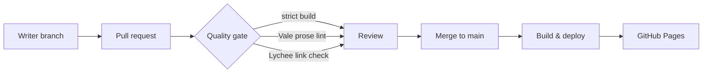

# Docs-as-code pipeline

This portfolio runs on the same pipeline I'd set up for a product team.

## Flow



## Components

| Stage | Tool | Fails the build when |
| --- | --- | --- |
| Source | Markdown in Git | — |
| Build | MkDocs + Material, `--strict` | A page is missing from navigation or an internal link is broken |
| Prose lint | Vale + Google style + project vocabulary | A rejected term or a style error appears |
| Links | Lychee | An external link returns an error |
| Deploy | GitHub Actions → GitHub Pages | The build fails |

## Why this matters for a docs team

- **Review like code.** Every change has a diff, an author and a reviewer.
- **Docs ship with features.** Writers and engineers work in the same pull request.
- **Quality is automated.** Reviewers spend their time on accuracy and clarity, not on catching
  banned words.
- **No lock-in.** Content is plain Markdown that moves to any other generator.

## Run it locally

```bash
python -m venv .venv && source .venv/bin/activate
pip install -r requirements.txt
mkdocs serve
```
